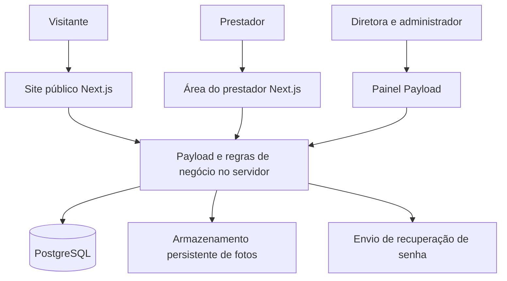

# Conecta Comunidade plano de desenvolvimento

O primeiro MVP permitirá que uma escola publique pequenos reparos, divulgue oportunidades por links, receba candidaturas e registre a seleção manual de um prestador. O desenvolvimento utilizará Next.js, TypeScript, Payload e PostgreSQL, com entregas demonstráveis e testes dos fluxos críticos.

As decisões abaixo consolidam o refinamento do [documento de requisitos](conecta-comunidade-requisitos.md). Para o desenvolvimento deste MVP, este plano define o recorte e resolve as alternativas que permanecem abertas naquele documento. A visão acadêmica e as condições de autorização institucional continuam aplicáveis.

O [roadmap de desenvolvimento](conecta-comunidade-roadmap.md) organiza os marcos, as tarefas e as dependências para executar este plano.

| Informação | Definição |
| --- | --- |
| Data da consolidação | 23/11/2026 |
| Situação | Homologação implantada e recuperação validada; M6 com backups e validação escolar adiados; M7 concluído como demonstração técnica para entrega acadêmica, sem piloto real ativado |
| Público do piloto | Uma escola e participantes adultos de sua comunidade |
| Primeira entrega do produto | Fluxo até a seleção, aguardando formalização externa |
| Prazo e disponibilidade da equipe | Em aberto |
| Custo recorrente alvo | R$ 0, utilizando recursos disponíveis; viabilidade de implantação a confirmar |
| Hospedagem | VPS Hostinger KVM 2 com homologação protegida por senha e domínio HTTPS; operação registrada no guia do M6 |

## 1 Escopo acordado

### Funcionalidades do MVP

- Cadastro inicial da escola e da diretora pelo administrador.
- Páginas públicas de apresentação, escola e detalhes das oportunidades.
- Publicação de oportunidades com valor fixo e até três fotos opcionais.
- Cópia e compartilhamento do link das oportunidades, inclusive pelo WhatsApp.
- Cadastro espontâneo, autenticação e recuperação de senha de prestadores.
- Perfil, envio de candidatura, edição, retirada, reenvio e acompanhamento do resultado.
- Consulta identificada dos candidatos pela diretora, seleção manual e tratamento de desistências.
- Encerramento de inscrições, cancelamento e encerramento sem seleção.
- Histórico de decisões e indicadores agregados por período.
- Administração de contas e bloqueios pelo painel; atendimento manual de solicitações de suporte e privacidade.

O desenvolvimento e a validação com a escola avançam em paralelo. Até a autorização institucional, demonstrações e testes utilizarão dados fictícios.

### Entregas posteriores

Acompanhamento da formalização, agendamento, execução e validação dos serviços compõe uma segunda entrega, condicionada às necessidades e autorizações da escola. Catálogo privado de profissionais, filtros avançados, anexos de candidatos, fotos de execução, notificações automáticas, exportações, questionários internos e medição de visitas ficam adiados.

Pagamentos, transações financeiras, emissão fiscal, chat, integração com a API do WhatsApp, seleção automática, rankings, cadastro de alunos, aplicativos nativos e operação de um marketplace com várias escolas permanecem fora do escopo. O MVP não exigirá que a diretora monte páginas ou arraste componentes.

## 2 Acesso e cadastro

| Perfil | Acesso |
| --- | --- |
| Visitante | Consulta páginas públicas e compartilha links, sem cadastro. |
| Prestador | Gerencia o próprio perfil e candidaturas pela interface do site. |
| Gestora | Usa o painel para administrar oportunidades e analisar candidatos da escola autorizada. |
| Administrador | Configura escola e contas, concede papéis, administra conteúdo institucional, bloqueios e suporte técnico. |

Uma única coleção autenticável representará os usuários. O cadastro público sempre cria um prestador. A concessão de papéis administrativos é restrita ao administrador e protegida no servidor. O acesso técnico a dados pessoais se limita ao necessário para administrar e dar suporte ao piloto.

### Cadastro do prestador

São obrigatórios nome completo, e-mail, senha, telefone de contato, vínculo comunitário autodeclarado, confirmação de maioridade e aceite dos termos e ciência do aviso de privacidade. Habilidades e apresentação profissional podem ser preenchidas depois.

Não haverá confirmação obrigatória do e-mail para enviar candidatura. A recuperação de senha continuará sendo feita por e-mail. O telefone é um dado de contato disponibilizado à direção, sem integração com ferramentas de comunicação.

Qualquer adulto que receba o link poderá se cadastrar e se candidatar. A diretora verifica o vínculo comunitário durante a análise, quando necessário. Não serão solicitados nomes de alunos ou documentos pessoais no cadastro inicial.

Após cadastro ou login iniciado em uma oportunidade, o usuário retorna a ela. A área do prestador conterá o próprio perfil e a página Minhas candidaturas.

## 3 Oportunidades e condições do serviço

O formulário de publicação deverá informar título, descrição, categoria, local de execução, prazo de candidatura, período ou prazo de execução, valor oferecido e responsabilidade por materiais e ferramentas. Requisitos técnicos e observações complementares serão opcionais.

O valor é fixo, apresentado pela diretora, e corresponde à remuneração total para executar o escopo nas condições publicadas. O candidato confirma concordância. Não haverá envio de orçamento pelo candidato nem pagamento na plataforma.

Exemplo de condições: R$ 500 pelo serviço; materiais fornecidos pela escola; ferramentas por conta do prestador.

### Fotografias

Cada oportunidade poderá ter até três fotos, enviadas pela diretora ou pelo administrador. A implementação deve validar arquivos no servidor, limitar formatos e tamanho e gerar versões reduzidas para celular. Os limites técnicos de tamanho e formatos serão definidos na implementação conforme o ambiente disponível.

O acesso às imagens deve acompanhar a visibilidade da oportunidade: fotos de rascunhos não podem ficar públicas. Imagens de alunos identificáveis e informações sensíveis da escola não devem ser publicadas.

### Alterações depois de receber candidaturas

A partir da primeira candidatura, ficam bloqueadas alterações de escopo, valor, responsabilidade por materiais e ferramentas e prazos, inclusive se a candidatura for retirada depois. Correções de escrita podem ser feitas desde que preservem as condições aceitas.

Mudanças nas condições exigem cancelar a oportunidade com justificativa e publicar outra. A nova publicação terá outro link, e os interessados precisarão se candidatar novamente. A oportunidade antiga continuará acessível com sua situação de cancelamento; a justificativa administrativa será preservada no histórico com acesso autorizado.

### Divulgação e páginas antigas

A página principal da escola exibe oportunidades abertas. Links antigos continuam acessíveis com os detalhes públicos e a situação atual, com a candidatura desabilitada quando as inscrições estiverem encerradas.

O WhatsApp será usado somente para compartilhar links. A aplicação não enviará notificações ou resultados por esse canal. Identidades e dados dos candidatos, inclusive do selecionado, não aparecem nas páginas públicas.

## 4 Candidaturas e seleção

### Envio e manutenção da candidatura

O envio exige autenticação, oportunidade aberta, prazo vigente, disponibilidade informada e concordância com o valor e as condições. Apresentação e experiência relevante são opcionais.

Enquanto as inscrições estiverem abertas, o prestador poderá editar, retirar e reenviar sua candidatura. Haverá apenas uma candidatura ativa por prestador e oportunidade, com preservação do histórico de alterações e reenvios. Um prestador poderá participar de várias oportunidades.

As condições aceitas e a data da concordância devem ser registradas. O prestador consulta somente suas próprias candidaturas. A diretora consulta os candidatos identificados de sua escola, com nome, contato, vínculo declarado, perfil e disponibilidade.

### Encerramento e decisão

O término do prazo bloqueia novas candidaturas. A diretora também pode encerrar as inscrições antecipadamente. A seleção só ocorre com as inscrições fechadas.

A confirmação da escolha marca uma candidatura como selecionada e as demais elegíveis como não selecionadas, preservando retiradas e decisões anteriores no histórico. A operação registra data e responsável. A oportunidade passa a seleção realizada, aguardando formalização externa; esse resultado não equivale a uma contratação.

A diretora pode encerrar sem selecionar ninguém, mesmo havendo candidatos, mediante justificativa. Cancelamento também exige justificativa e deve ser distinguido de encerramento sem seleção.

### Desistência do selecionado

A diretora registra o motivo, desfaz a seleção e retorna a oportunidade para análise. Poderá reconsiderar candidatos existentes, inclusive uma candidatura anteriormente não selecionada. As inscrições continuam fechadas, e as decisões anteriores permanecem no histórico.

### Acompanhamento pelo prestador

Minhas candidaturas mostra situação, condições aceitas e resultado. A interface orientará o participante a voltar para acompanhar a decisão. Notificações automáticas de candidatura e seleção ficam adiadas; os e-mails de recuperação de acesso permanecem previstos.

## 5 Estados e operações

O fluxo da oportunidade no MVP utiliza os estados já propostos nos requisitos, limitados ao recorte aprovado:

| Estado | Situação apresentada |
| --- | --- |
| `DRAFT` | Rascunho, restrito à gestão. |
| `OPEN` | Publicada, recebendo candidaturas dentro do prazo. |
| `UNDER_REVIEW` | Inscrições encerradas, em análise. |
| `AWAITING_FORMALIZATION` | Seleção realizada, aguardando formalização externa. |
| `CLOSED_WITHOUT_SELECTION` | Encerrada sem seleção, com justificativa. |
| `CANCELLED` | Cancelada, com justificativa. |

Fluxo principal: `DRAFT → OPEN → UNDER_REVIEW → AWAITING_FORMALIZATION`. O registro de desistência do selecionado permite retornar de `AWAITING_FORMALIZATION` para `UNDER_REVIEW`, mantendo as inscrições fechadas.

O bloqueio pelo prazo deve ser aplicado no servidor mesmo que uma rotina de atualização visual de estado ainda não tenha executado. Estados de execução e conclusão do serviço ficam para a segunda entrega.

A diretora utilizará ações explícitas como Publicar, Encerrar inscrições, Selecionar candidato, Registrar desistência, Encerrar sem seleção e Cancelar. Essas ações validam permissões e condições e atualizam os registros relacionados de forma consistente. A interface não permitirá editar livremente códigos de estado.

## 6 Arquitetura e dados

Uma aplicação Next.js com TypeScript conterá o site público, a área do prestador, o painel e as APIs do Payload. PostgreSQL será o banco previsto, com disponibilidade a confirmar na hospedagem.

### Organização interna

| Módulo | Responsabilidade |
| --- | --- |
| Conteúdo institucional | Textos, imagens e informações públicas editáveis pelo administrador, em layouts definidos no desenvolvimento. |
| Usuários e acesso | Autenticação, papéis, associação à escola, perfil, bloqueios e recuperação de senha. |
| Oportunidades | Publicação, prazos, condições, fotos e encerramento. |
| Candidaturas e seleção | Envio, edição, retirada, reenvio, decisão e desistência do escolhido. |
| Histórico | Operações relevantes, responsáveis, datas e motivos, com minimização de dados pessoais. |
| Indicadores | Consultas agregadas por período, restritas à diretora e ao administrador. |

### Referência para detalhamento do modelo

As coleções e campos serão detalhados na primeira entrega, preservando estas responsabilidades:

| Informação | Conteúdo |
| --- | --- |
| Escola | Identidade da instituição, informações públicas e configuração do piloto. |
| Usuário | Credencial, papel, situação da conta, associação à escola e dados de contato. |
| Perfil profissional | Vínculo autodeclarado, habilidades e apresentação, associado ao usuário. |
| Categoria | Classificação dos serviços e habilidades. |
| Oportunidade | Escola, autor, condições, prazo, valor fixo, estado e seleção vigente. |
| Candidatura | Prestador, oportunidade, disponibilidade, concordância, situação e datas. |
| Imagem | Arquivo, metadados necessários e associação à oportunidade. |
| Histórico | Ação, entidade, responsável, data e motivo quando aplicável. |

A escola estará representada explicitamente, embora o piloto opere uma única instituição. As regras devem impedir acesso a dados de uma instituição não autorizada.

### Integridade no servidor

- Validar permissões tanto nas APIs quanto nas chamadas internas feitas em nome do usuário.
- Proteger papéis e associações à escola contra alteração pelo cadastro público ou pelo próprio prestador.
- Garantir unicidade de candidatura e de seleção com restrições de banco e operações transacionais, testadas sob concorrência.
- Registrar seleção, alteração das demais candidaturas e histórico como uma operação consistente.
- Aplicar bloqueios de prazo e de alteração das condições mesmo em requisições diretas às APIs.
- Manter dados individuais fora de respostas públicas e logs técnicos desnecessários.

Hooks, permissões e operações específicas complementarão o backend do Payload. O desenho não deve depender apenas de verificar a existência de um registro antes de gravar outro, pois ações simultâneas precisam preservar as mesmas regras.

## 7 Indicadores do MVP

O painel apresentará os seis indicadores acordados, com consulta por período:

| Indicador | Apuração |
| --- | --- |
| Prestadores cadastrados | Contas de prestadores criadas no período. |
| Prestadores participantes | Prestadores distintos que enviaram candidatura no período. |
| Oportunidades publicadas | Demandas efetivamente publicadas no período. |
| Candidaturas recebidas | Candidaturas submetidas, com rastreabilidade da primeira submissão e dos reenvios. |
| Oportunidades com candidatos | Percentual das oportunidades publicadas no período que receberam candidatura. |
| Tempo até a primeira candidatura | Intervalo entre publicação e primeira candidatura nas oportunidades que receberam interesse. |

No detalhamento da entrega de indicadores, as consultas deverão explicitar a convenção de contagem dos reenvios e o intervalo de observação, mantendo denominadores consistentes. Retirada, cancelamento e desistência não devem apagar o registro histórico de participação.

O MVP não medirá visitas, visitantes únicos, alcance no WhatsApp, serviços concluídos ou renda gerada. Feedback e entrevistas poderão ser coletados externamente para o experimento acadêmico.

## 8 Entregas e critérios de aceite

Cada entrega deve terminar com uma demonstração funcional e os testes relevantes executados. A divisão abaixo estabelece dependências, sem atribuir datas ou horas à equipe.

### Entrega 1 Base e acessos

Configurar Next.js, TypeScript, Payload, PostgreSQL de desenvolvimento, estrutura dos módulos, modelo inicial e dados fictícios. Implementar papéis e permissões e o cadastro administrativo da escola e da diretora.

Aceite: o administrador configura a escola e gestora; a gestora acessa somente o contexto autorizado; o prestador não entra no painel; tentativas de elevar privilégios ou acessar dados alheios são negadas no servidor. Incluir a configuração e validação inicial da recuperação de senha por e-mail.

### Entrega 2 Publicação e divulgação

Implementar conteúdo institucional, páginas públicas, criação e publicação de oportunidades, valor fixo, condições, até três fotos e compartilhamento do link.

Aceite: a diretora publica uma oportunidade com foto; o visitante abre o link pelo celular sem login; o link pode ser copiado e compartilhado; rascunhos e seus arquivos permanecem restritos; a listagem principal exibe oportunidades abertas.

Realizar a primeira avaliação do painel com a diretora, usando dados fictícios e a tarefa de publicação.

### Entrega 3 Participação

Implementar cadastro, perfil, login com retorno à oportunidade, candidatura, edição, retirada, reenvio e Minhas candidaturas. A candidatura será permitida sem confirmação do e-mail.

Aceite: o prestador informa disponibilidade e concordância, consulta somente seus próprios registros e consegue editar, retirar e reenviar enquanto as inscrições estiverem abertas. Tentativas duplicadas e inscrições fora do prazo são impedidas. As condições ficam protegidas após a primeira candidatura.

Assim que houver consulta de candidatos, ampliar a avaliação do painel da diretora para essa tarefa.

### Entrega 4 Seleção e exceções

Implementar análise identificada, encerramento antecipado, seleção manual, marcação dos demais candidatos, desistência do selecionado, reconsideração, cancelamento e encerramento sem seleção.

Aceite: somente uma seleção pode permanecer vigente, inclusive sob requisições simultâneas. A desistência retorna a oportunidade para análise sem reabrir inscrições. Motivos, responsáveis e datas ficam registrados. Links antigos exibem a situação atual sem expor candidatos.

Completar o teste do painel com as três tarefas pelo celular: publicar com foto, consultar candidatos e selecionar um prestador. Se a diretora conseguir executá-las sem orientação passo a passo, aproveitar o painel. Caso contrário, adaptar as telas ou construir a interface necessária antes de encerrar esta entrega.

### Entrega 5 Preparação do piloto

Implementar indicadores agregados, completar conteúdo institucional, termos e aviso de privacidade validados, informar o canal de suporte e concluir a avaliação dos percursos pelo celular.

Aceite: indicadores conferem com registros de teste; cadastro, recuperação de acesso, candidatura e seleção funcionam no ambiente de destino; há responsável por suporte e administração; implantação e restauração estão verificadas; as condições de autorização da escola estão atendidas antes do uso real.

A preparação técnica pode avançar enquanto a escola valida o experimento. A ativação do piloto depende das pendências da seção 11.

## 9 Verificação e qualidade

Vitest será utilizado para regras e testes de integração com PostgreSQL. Playwright será utilizado para os percursos de navegador, incluindo telas de celular. Os testes acompanham as entregas e devem verificar comportamento e permissões reais.

Priorizar os seguintes cenários:

1. Cadastro público sempre cria prestador e não permite conceder privilégios.
2. Prestador e visitante não acessam candidaturas ou contatos de outros participantes.
3. Gestão permanece restrita à escola autorizada, inclusive em chamadas diretas ao servidor.
4. Cadastro e login retornam à oportunidade; recuperação de senha funciona sem exigir confirmação prévia do e-mail.
5. Envio exige disponibilidade e concordância e respeita prazo e estado da oportunidade.
6. Envios concorrentes não produzem candidaturas duplicadas.
7. Edição, retirada e reenvio preservam a regra de candidatura única e o histórico.
8. Alterações de condições são bloqueadas após a primeira candidatura.
9. Seleções concorrentes não deixam dois candidatos selecionados nem decisões parcialmente gravadas.
10. Desistência, reconsideração, cancelamento e encerramento sem seleção mantêm histórico consistente.
11. Upload respeita quantidade, permissões, formatos e tamanho, e rascunhos não expõem fotos.
12. Páginas antigas, Minhas candidaturas e indicadores refletem os registros efetivos.

A avaliação manual deverá observar clareza dos textos, erros de formulário, navegação, legibilidade e facilidade de executar as tarefas pelo celular. As dificuldades encontradas orientam correções antes da ativação.

## 10 Infraestrutura e recuperação

### Ambientes

Desenvolvimento e demonstrações utilizarão dados fictícios. O ambiente do piloto terá banco, arquivos e configurações separados, recebendo dados reais somente após autorização da escola. A forma de disponibilizar as demonstrações será escolhida conforme os recursos existentes.

### Hospedagem e pendências

O usuário confirmou uma VPS Hostinger KVM 2, acessível por `ssh masque-vps`. Em M6, Docker/Compose, capacidade e PostgreSQL próprio do Conecta foram verificados com homologação privada. A implantação usa imagem Node.js 24.22.3 com build Next.js e migrações explícitas do Payload. Banco e fotos têm diretórios persistentes separados por ambiente; a outra aplicação da VPS permanece no projeto Docker existente. O guia [M6 Implantação e ativação](docs/m6-implantacao-ativacao.md) registra operação e evidências. O domínio `redeconectacomunidade.com.br`, adquirido na Hostinger, está apontado para a VPS e com HTTPS verificado. O acesso à homologação pelo domínio é protegido por senha; SMTP Hostinger configurado em 25/11/2026, com autenticação TLS aprovada e solicitação de recuperação enviada pela aplicação; recebimento, redefinição e login foram confirmados pelo usuário em 25/11/2026.

Antes da ativação, verificar os itens abaixo; o guia do M6 registra o que já foi exercitado:

- Suporte à execução da aplicação Next.js e Payload e à versão Node.js compatível com as dependências escolhidas.
- Disponibilidade e conexão com PostgreSQL.
- Armazenamento persistente para fotos, preservado em novas implantações.
- Domínio, HTTPS e configuração de acesso público.
- Envio de e-mail para recuperação de senha, por SMTP ou adaptador compatível disponível.
- Processo de build, atualização da aplicação e aplicação das migrações do banco.
- Capacidade disponível e compatibilidade com o custo recorrente alvo.

Versões das dependências serão escolhidas e fixadas no início da implementação, respeitando a compatibilidade entre Payload, Next.js e o ambiente de execução.

### Backups

A política acordada prevê backup diário do banco e das fotos, cópia antes de atualizações e armazenamento separado da instalação. Antes do piloto, será realizado um teste de restauração.

O backup informado da Hostinger poderá atender a essa política se forem confirmados frequência, abrangência do PostgreSQL e das fotos, destino das cópias e procedimento de recuperação. A cobertura desses itens ainda não foi verificada. Em M6, um backup explícito de banco e fotos fictícios foi restaurado em destino vazio separado na VPS, com conferência de registros, histórico e hashes das fotos. Isso não comprova cobertura da Hostinger, agendamento diário ou cópia fora da VPS; essas lacunas deverão ser resolvidas antes de receber dados reais.

## 11 Pendências e condições para ativação

| Pendência | Encaminhamento |
| --- | --- |
| Prazo de entrega e capacidade da equipe | Permanecem em aberto por decisão do usuário; dimensionar calendário depois. |
| Plano e recursos da Hostinger | VPS KVM 2 confirmada e homologação privada implantada; concluir a rotina diária e a cobertura externa dos backups antes da ativação. |
| Escola participante e autorização do piloto | Grupo valida com a direção e o professor. |
| Demandas reais, categorias e condições do serviço | Diretora valida os reparos, valores, materiais, ferramentas e prazos. |
| Recursos e procedimentos de contratação | Escola confirma condições antes de divulgar oportunidades como contratações reais. |
| Termos, privacidade e retenção | Definir com a instituição responsável as finalidades, responsáveis, retenção e atendimento dos pedidos. |
| Pesquisa e participação dos adultos | Grupo e professor confirmam as autorizações e exigências institucionais aplicáveis. |
| Suporte e administração | Definir responsável e canal externo antes da divulgação. |
| Duração e encerramento do piloto | Definir período e responsável pela continuidade ou encerramento ao término da disciplina. |
| Usabilidade do painel da diretora | Validar durante as entregas 2 a 4 e adaptar conforme os resultados. |
| Convenções dos indicadores | Detalhar contagem de reenvios e períodos na entrega 5, antes de usar resultados na avaliação acadêmica. |

O planejamento técnico pode ser executado com dados fictícios enquanto essas definições são tratadas. A divulgação com participantes e dados reais exige autorização, conteúdo validado e condições operacionais verificadas.

### Conclusão acadêmica da demonstração técnica

Em 25/11/2026, o usuário decidiu finalizar a entrega acadêmica como demonstração técnica do MVP e adiar o piloto com a escola. O M7 foi concluído nesse recorte, com relatório de objetivo, método, resultados, indicadores da homologação, análise das hipóteses, limitações e decisão de escopo. Os registros de teste não são evidência de adesão espontânea, contratação ou renda. A homologação protegida é mantida para apresentação; não foi solicitado desligamento da infraestrutura ou descarte dos registros. O período do experimento real, seus responsáveis e sua decisão institucional de continuidade ou encerramento serão tratados no piloto futuro. Consulte o [relatório final do M7](docs/m7-avaliacao-encerramento.md).

## 12 Relação com os requisitos iniciais

| Referência | Decisão consolidada para o MVP |
| --- | --- |
| DEC-10 e RN-04 | Consulta pública sem cadastro; candidatura autenticada. |
| DEC-11 e RN-17 | Formalização e pagamentos permanecem externos. |
| DEC-12 e RF-16 | WhatsApp limitado ao compartilhamento de links; contato disponível como dado, sem integração. |
| DEC-13 e RF-21 | Catálogo privado de profissionais adiado. |
| DEC-14 e seção 9.2 | Somente valor fixo apresentado pela diretora e aceito pelo candidato. |
| RF-02 | Login e recuperação de acesso por e-mail; confirmação do e-mail não é condição para candidatura. |
| RF-09 | Fotos promovidas ao escopo do MVP, com até três por oportunidade. |
| RF-12 e RN-14 | Edição, retirada e reenvio pelo prestador enquanto as inscrições estiverem abertas; após seleção, desistência registrada pela diretora. |
| RF-17 a RF-19 e RF-22 | Formalização, execução, validação e evidências de execução ficam para uma segunda entrega. |
| RF-23 e seção 20.3 | Seis indicadores de adesão e candidaturas; visitas e resultados de execução adiados. |
| RF-24 e RF-25 | Exportações e questionários internos adiados; feedback pode ser externo. |
| RF-26 | Gestão no painel e atendimento manual de pedidos pelo canal de suporte. |
| RF-27 | Consulta de situação no site; notificações automáticas adiadas. |
| RN-21 | Condições protegidas após a primeira candidatura; mudanças exigem cancelamento e nova publicação. |
| Seção 23 | Stack e sequência de cinco entregas definidas neste plano; cronograma permanece em aberto. |

## 13 Referências técnicas

- [Instalação do Payload](https://payloadcms.com/docs/getting-started/installation) e [configuração](https://payloadcms.com/docs/configuration/overview).
- [Painel e papéis de acesso](https://payloadcms.com/docs/admin/overview) e [controle de acesso](https://payloadcms.com/docs/access-control/overview).
- [PostgreSQL](https://payloadcms.com/docs/database/postgres), [transações](https://payloadcms.com/docs/database/transactions) e [índices](https://payloadcms.com/docs/database/indexes).
- [Uploads](https://payloadcms.com/docs/upload/overview), [envio de e-mail](https://payloadcms.com/docs/email/overview) e [implantação](https://payloadcms.com/docs/production/deployment).
- [Template oficial com Vitest e Playwright](https://github.com/payloadcms/payload/blob/main/templates/blank/package.json).
- [Hospedagem própria de Next.js](https://nextjs.org/docs/app/guides/self-hosting) e [backup do PostgreSQL](https://www.postgresql.org/docs/current/backup.html).
