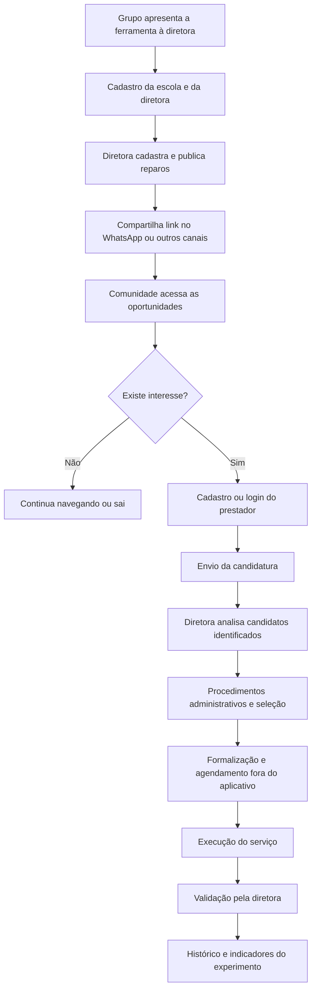
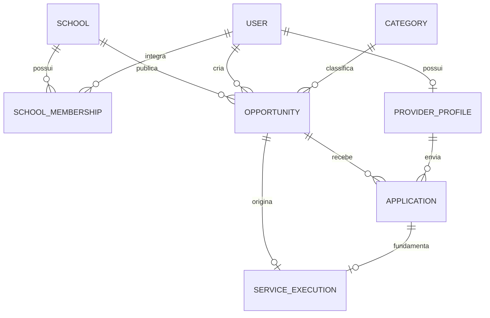

# Conecta Comunidade
## Documento de visão, escopo e requisitos — projeto-piloto escolar

| Informação | Descrição |
| --- | --- |
| Projeto | Conecta Comunidade |
| Disciplina | Cibercultura |
| Produto | Aplicação web responsiva |
| Versão | 0.1 — refinamento inicial |
| Data | 23/11/2026 |
| Situação | Em levantamento e validação de requisitos |
| Ambiente experimental | Uma instituição de ensino |

> Este documento consolida a proposta original do Conecta Comunidade e as definições discutidas para o experimento escolar. Requisitos identificados como propostos ainda deverão ser validados pelo grupo e, quando necessário, pela direção da escola. Não representa autorização para contratar ou utilizar recursos escolares.

## 1. Contextualização

O Conecta Comunidade foi originalmente concebido como uma plataforma para conectar pessoas, famílias e instituições que necessitam de serviços, cuidados ou apoio a profissionais e voluntários capazes de oferecê-los.

Durante a disciplina de Cibercultura, o projeto foi refinado com a orientação do professor para delimitar um público-alvo e viabilizar um experimento com participantes reais. A instituição escolhida será uma escola com a qual o professor estabeleceu contato.

Segundo as informações preliminares, a escola costuma dispor, ao final do ano, de recursos remanescentes que podem ser utilizados em pequenos reparos. A origem, disponibilidade, finalidade permitida e procedimentos de utilização desses recursos ainda precisam ser confirmados com a diretora.

A proposta consiste em disponibilizar uma aplicação web na qual a diretora possa cadastrar demandas de manutenção e divulgá-las à comunidade escolar. Pais, responsáveis, familiares e conhecidos poderão acessar as oportunidades, cadastrar-se espontaneamente e manifestar interesse na realização dos serviços.

O aplicativo será utilizado como instrumento de um experimento social mediado por tecnologia, e não apenas como uma ferramenta de gestão ou contratação de serviços.

## 2. Problema e oportunidade

A escola possui necessidades de manutenção, enquanto pessoas pertencentes à sua comunidade podem possuir habilidades profissionais adequadas para atendê-las. Entretanto, essas competências podem não ser conhecidas pela direção, e a divulgação de oportunidades pode depender de indicações informais e canais de comunicação dispersos.

A hipótese do projeto é que uma plataforma digital, integrada à dinâmica de comunicação já existente na escola, pode facilitar a descoberta dessas competências, a divulgação das demandas e a mobilização comunitária.

### 2.1. Pergunta de pesquisa

Como uma plataforma digital pode contribuir para a mobilização da comunidade escolar, conectando demandas de manutenção da escola às habilidades profissionais de pais, responsáveis e pessoas de sua rede de relacionamentos?

### 2.2. Objetivo geral

Desenvolver e experimentar uma aplicação web que facilite a conexão entre necessidades de manutenção de uma escola e prestadores de serviços de sua comunidade, avaliando a adesão, a participação e as possibilidades de colaboração mediadas pela tecnologia.

### 2.3. Objetivos específicos

- Permitir que a direção divulgue e gerencie oportunidades de pequenos reparos.
- Facilitar o acesso da comunidade às oportunidades por meio de links compartilháveis.
- Possibilitar o cadastramento espontâneo de prestadores e o envio de candidaturas.
- Dar à diretora acesso à identidade e às informações relevantes dos candidatos, permitindo análise e seleção manual.
- Acompanhar o encaminhamento e, quando viável, a execução das demandas.
- Identificar competências profissionais existentes na comunidade escolar.
- Investigar a adesão, a inclusão digital, a confiança e o engajamento comunitário.
- Avaliar oportunidades de geração de renda local, quando houver contratação efetiva.

## 3. Fundamentação na disciplina de Cibercultura

O aplicativo atua como mediador de relações sociais já existentes. A escola constitui um núcleo de articulação comunitária; o ambiente digital amplia a visibilidade das demandas e das competências de seus membros.

| Conceito | Relação com o projeto |
| --- | --- |
| Inteligência coletiva | Descoberta e articulação de habilidades distribuídas na comunidade. |
| Cultura participativa | Adesão espontânea e participação dos membros da comunidade. |
| Redes sociais e colaboração | Circulação das oportunidades pelos grupos e contatos pessoais. |
| Capital social | Relações de confiança, pertencimento e vínculos comunitários. |
| Inclusão digital | Acesso a oportunidades por uma interface simples e acessível. |
| Cidadania digital | Uso da tecnologia para atender necessidades de interesse coletivo. |
| Economia local | Possibilidade de gerar trabalho e circulação de renda na comunidade. |

A proposta dialoga com o conceito de inteligência coletiva de Pierre Lévy e com os ODS 8 (Trabalho decente e crescimento econômico), 11 (Cidades e comunidades sustentáveis) e 17 (Parcerias e meios de implementação), apresentados no documento original. Trata-se de alinhamento potencial, não de comprovação de impacto.

## 4. Decisões consolidadas e premissas

| ID | Definição | Situação |
| --- | --- | --- |
| DEC-01 | O piloto será realizado em uma escola. | Definida |
| DEC-02 | O grupo apresentará a ferramenta à diretora e realizará seu cadastro inicial. | Definida |
| DEC-03 | A diretora poderá cadastrar as demandas de reparo. | Definida |
| DEC-04 | A diretora divulgará o site e/ou oportunidades por WhatsApp e compartilhamento de links nos grupos da escola. | Definida |
| DEC-05 | O cadastro de pais, responsáveis e conhecidos será espontâneo. | Definida |
| DEC-06 | Os participantes poderão candidatar-se aos serviços divulgados. | Definida |
| DEC-07 | A diretora terá acesso à identidade dos prestadores e às informações necessárias à análise e seleção. | Definida |
| DEC-08 | Não haverá anonimização de candidatos para a contratação, seleção às cegas ou seleção automatizada. | Definida |
| DEC-09 | O piloto terá foco em pequenos reparos remunerados, condicionado à disponibilidade e às regras da verba. | Direcionamento definido; execução a validar |
| DEC-10 | A visualização de oportunidades será possível sem cadastro; a autenticação será exigida para candidatar-se. | Proposta |
| DEC-11 | Pagamentos e formalização contratual ocorrerão fora do aplicativo. | Proposta |
| DEC-12 | A comunicação ocorrerá diretamente entre as partes, preferencialmente por WhatsApp. | Proposta |
| DEC-13 | A escola terá um catálogo privado dos profissionais cadastrados. | Proposta |
| DEC-14 | A diretora poderá escolher entre valor fixo e recebimento de orçamentos. | Proposta a validar |

## 5. Público-alvo e perfis de acesso

### 5.1. Visitante

Pessoa que recebe o link ou acessa o site. Poderá conhecer o projeto, visualizar as oportunidades abertas e consultar seus detalhes sem precisar criar uma conta (proposta).

### 5.2. Prestador de serviços

Pessoa adulta que possui interesse em realizar serviços para a escola, como pai, mãe, responsável, familiar ou conhecido de uma família da comunidade escolar.

Poderá criar sua própria conta, cadastrar informações profissionais, consultar oportunidades, enviar candidaturas, acompanhar seus resultados e, quando selecionado, registrar o andamento do serviço.

O vínculo comunitário poderá inicialmente ser autodeclarado. Não se pretende cadastrar alunos nem exigir identificação de crianças ou adolescentes.

### 5.3. Gestor escolar (diretora)

Usuária cadastrada pelo grupo acadêmico e responsável pela gestão das demandas da escola.

Terá acesso identificado aos prestadores da sua escola, às candidaturas, aos contatos, às habilidades e às propostas financeiras. Poderá analisar os candidatos, entrar em contato diretamente, registrar a seleção e validar os serviços, observadas as autorizações administrativas e regras de contratação aplicáveis.

A diretora não dependerá de algoritmo, sorteio, classificação automática ou ocultação de informações para decidir sobre a seleção.

### 5.4. Administrador do sistema (grupo acadêmico)

Responsável pelo cadastro inicial da escola e da diretora, configuração da aplicação, suporte e administração técnica. O acesso a informações pessoais deverá se limitar ao necessário para essas atividades.

A análise acadêmica deverá utilizar preferencialmente dados agregados ou anonimizados, sem confundir a identificação necessária à contratação com os dados destinados à pesquisa.

## 6. Jornada principal do experimento

1. O grupo acadêmico apresenta a aplicação à diretora e configura seu acesso.
2. A diretora identifica e cadastra as demandas de manutenção da escola.
3. As oportunidades são publicadas e divulgadas em grupos de WhatsApp ou por outros canais.
4. Pais, responsáveis e conhecidos acessam o site e consultam as oportunidades.
5. Os interessados realizam cadastro/login e enviam suas candidaturas.
6. A diretora consulta os perfis identificados, propostas e contatos dos candidatos.
7. A direção encaminha a seleção e os procedimentos administrativos necessários.
8. Após a formalização, o serviço é agendado e executado, se autorizado.
9. A diretora valida a execução e encerra a oportunidade.
10. O grupo avalia os indicadores e o feedback dos participantes.

Uma oportunidade poderá ser cancelada, encerrada sem seleção ou não receber candidatos. Essas ocorrências também são resultados relevantes para o experimento.

## 7. Divulgação e ingresso na comunidade

O WhatsApp será o principal canal inicial de mobilização. Não haverá necessidade de integração com a API do WhatsApp, acesso a conversas privadas ou importação dos participantes dos grupos.

Propõe-se disponibilizar dois tipos de links:

- Página da escola, contendo todas as oportunidades abertas: `/escolas/{slug}`.
- Página de uma oportunidade específica: `/oportunidades/{id}`.

Os caminhos são ilustrativos e não constituem decisão de arquitetura.

A diretora poderá copiar os links ou acionar um botão de compartilhamento que prepare uma mensagem para o WhatsApp. Os visitantes poderão encaminhar o link a familiares e conhecidos.

O cadastro será solicitado somente quando o visitante desejar candidatar-se ou criar seu perfil. Após a autenticação, a aplicação deverá retornar à oportunidade que motivou o cadastro, evitando etapas desnecessárias.

A publicação por link não constitui comprovação de vínculo escolar. O vínculo será declarado pelo prestador e poderá ser verificado pela direção quando necessário.

## 8. Escopo de serviços

O piloto deverá priorizar serviços pontuais, simples e de baixo risco, autorizados pela escola.

| Categoria | Exemplos |
| --- | --- |
| Pintura | Paredes, muros, portas e portões. |
| Jardinagem | Corte de grama e manutenção de jardins. |
| Marcenaria | Pequenos reparos em mesas, cadeiras e armários. |
| Hidráulica simples | Substituição de torneiras e correção de pequenos vazamentos. |
| Manutenção geral | Maçanetas, fechaduras e pequenos ajustes. |
| Conservação | Limpeza pontual e organização de espaços. |

Atividades estruturais, elétricas, em altura, com materiais perigosos ou outros riscos relevantes não deverão integrar o piloto sem avaliação específica, autorização e qualificação profissional exigida. Os trabalhos devem ocorrer em condições seguras, preferencialmente sem circulação de alunos na área de execução.

As categorias são propostas e poderão ser ajustadas às necessidades reais da escola.

## 9. Cadastro de oportunidades

A oportunidade será a entidade central da aplicação e representará uma necessidade concreta da escola.

### 9.1. Campos propostos

| Campo | Obrigatoriedade proposta | Observação |
| --- | --- | --- |
| Título | Sim | Nome resumido do reparo. |
| Descrição | Sim | Detalhamento da necessidade e do resultado esperado. |
| Categoria | Sim | Tipo de serviço. |
| Local de execução | Sim | Área da escola; evitar divulgação de informações sensíveis. |
| Fotografias | Não | Evidências da situação atual, sem alunos identificáveis. |
| Prazo para candidaturas | Sim | Limite para manifestação de interesse. |
| Prazo ou período de execução | Sim | Data limite ou janela disponível. |
| Modalidade de remuneração | Sim | Valor fixo ou recebimento de orçamentos, a validar. |
| Valor oferecido/estimado | Condicional | Conforme a modalidade escolhida. |
| Responsabilidade pelos materiais | Sim | Escola, prestador ou responsabilidade compartilhada. |
| Requisitos técnicos | Não | Experiência, ferramentas ou qualificações necessárias. |
| Observações | Não | Condições complementares de acesso e execução. |
| Status | Sistema | Estado atual da oportunidade. |
| Autor e data de criação | Sistema | Rastreabilidade administrativa. |

### 9.2. Modelo de remuneração (em aberto)

- **Valor fixo:** a diretora informa o valor oferecido e o candidato manifesta concordância.
- **Recebimento de orçamentos:** o candidato apresenta sua proposta financeira e condições de execução.
- **Modelo flexível (recomendado):** a diretora escolhe uma das modalidades ao publicar cada oportunidade.

O aplicativo não deverá funcionar como leilão ou selecionar automaticamente o menor preço. A escolha deverá seguir as regras de contratação da instituição, inclusive eventuais critérios objetivos obrigatórios. A plataforma não substitui pesquisa de preços, documentação fiscal ou prestação de contas exigida.

### 9.3. Exemplo ilustrativo

| Campo | Exemplo fictício |
| --- | --- |
| Título | Pintura de duas salas de aula |
| Categoria | Pintura |
| Descrição | Preparar as superfícies e pintar as paredes internas de duas salas. |
| Orçamento estimado | R$ 850,00 |
| Modalidade | Recebimento de orçamentos |
| Materiais | Fornecidos pela escola |
| Prazo | Até três dias, em período previamente combinado |
| Requisitos | Experiência em pintura interna |
| Status | Aberta para candidaturas |

## 10. Cadastro do prestador

O cadastro deverá ser simples, adaptado à utilização por celular e não exigir informações desnecessárias à candidatura.

| Campo | Obrigatoriedade proposta |
| --- | --- |
| Nome completo | Sim |
| E-mail | Conforme método de autenticação |
| Telefone/WhatsApp | Sim |
| Credencial de autenticação | Conforme método escolhido |
| Confirmação de maioridade | Sim |
| Vínculo declarado com a comunidade escolar | Sim |
| Categoria(s) de habilidade profissional | Opcional no cadastro inicial |
| Descrição profissional e experiência | Não |
| Foto de perfil | Não |
| Aceite dos termos de uso e ciência do aviso de privacidade | Sim |

Vínculos sugeridos: pai, mãe ou responsável; familiar de aluno; amigo ou conhecido de uma família; ex-aluno adulto; membro da comunidade local; outro. A elegibilidade definitiva será validada com a direção.

Não se pretende exigir CPF, endereço residencial, documentos pessoais ou nome dos alunos no cadastro inicial. Informações necessárias à contratação formal poderão ser solicitadas pela escola nos procedimentos adequados.

## 11. Candidaturas e seleção de prestadores

### 11.1. Envio da candidatura

O prestador autenticado poderá consultar uma oportunidade aberta e enviar sua manifestação de interesse. A candidatura ficará associada ao perfil identificado do usuário.

Campos propostos:

- Apresentação ou mensagem à diretora.
- Experiência relevante para aquele serviço.
- Disponibilidade e estimativa de prazo de execução.
- Proposta financeira, quando a modalidade exigir, ou concordância com o valor fixo.
- Informações sobre materiais e condições da proposta, quando aplicável.
- Anexos comprobatórios opcionais, se necessários ao serviço.

### 11.2. Análise pela diretora

A diretora poderá consultar todas as candidaturas da oportunidade, visualizar a identidade dos candidatos, acessar seus perfis completos dentro do escopo da aplicação e comparar as propostas.

Informações como nome, telefone, vínculo comunitário, habilidades, experiência, prazo e valor proposto estarão disponíveis à direção. Não haverá mascaramento da identidade dos prestadores para a contratação.

A diretora poderá entrar em contato com o interessado, esclarecer dúvidas, registrar uma decisão de seleção ou recusa e acompanhar as etapas seguintes. Recomenda-se registrar data, responsável e justificativa da decisão quando pertinente.

A seleção no aplicativo não equivale à formalização da contratação nem autoriza o início do serviço por si só.

### 11.3. Visibilidade de informações

| Informação | Visitante | Outro prestador | Próprio prestador | Diretora da escola |
| --- | --- | --- | --- | --- |
| Dados públicos da oportunidade | Sim | Sim | Sim | Sim |
| Nome e contato do candidato | Não | Não | Sim | Sim |
| Vínculo comunitário e perfil profissional | Não | Não | Sim | Sim |
| Proposta financeira individual | Não | Não | Sim | Sim |
| Status e histórico de candidaturas | Não | Não | Sim | Sim |
| Histórico de serviços do prestador na escola | Não | Não | Sim | Sim |

O controle da diretora sobre as informações da contratação não implica exposição pública de dados pessoais. A eventual divulgação de informações exigida por normas de transparência seguirá os procedimentos oficiais aplicáveis.

### 11.4. Catálogo privado de profissionais (proposta)

A direção poderá consultar prestadores vinculados à escola mesmo quando não possuírem candidaturas ativas, desde que essa finalidade seja informada no cadastro. Filtros por habilidade e vínculo poderão auxiliar na descoberta das competências existentes na comunidade.

Esta funcionalidade não deverá ser utilizada para contornar os procedimentos de seleção exigidos para o uso dos recursos da escola.

## 12. Ciclo de vida e estados

### 12.1. Oportunidade (proposta)

| Estado | Significado |
| --- | --- |
| `DRAFT` | Rascunho não publicado. |
| `OPEN` | Publicada e recebendo candidaturas. |
| `UNDER_REVIEW` | Recebimento encerrado; análise dos interessados. |
| `AWAITING_FORMALIZATION` | Candidato selecionado; aguarda formalização externa. |
| `SCHEDULED` | Contratação autorizada/formalizada e execução combinada. |
| `IN_PROGRESS` | Serviço em execução. |
| `AWAITING_VALIDATION` | Prestador informa conclusão; aguarda verificação. |
| `COMPLETED` | Execução validada pela diretora. |
| `CLOSED_WITHOUT_SELECTION` | Encerrada sem contratação. |
| `CANCELLED` | Cancelada, com registro do motivo. |

Fluxo principal: `DRAFT → OPEN → UNDER_REVIEW → AWAITING_FORMALIZATION → SCHEDULED → IN_PROGRESS → AWAITING_VALIDATION → COMPLETED`.

A diretora poderá devolver um serviço para correção, reabrir uma oportunidade quando permitido ou encerrar sem seleção. Cancelamentos após formalização deverão respeitar as condições administrativas aplicáveis.

### 12.2. Candidatura (proposta)

| Estado | Significado |
| --- | --- |
| `SUBMITTED` | Candidatura enviada. |
| `UNDER_REVIEW` | Em análise pela direção. |
| `SELECTED` | Candidato selecionado para encaminhamento da contratação. |
| `NOT_SELECTED` | Candidato não selecionado. |
| `WITHDRAWN` | Candidatura retirada pelo prestador antes da formalização. |
| `CANCELLED` | Candidatura encerrada em razão do cancelamento da oportunidade ou seleção. |

O status de uma candidatura é independente do status da oportunidade. Uma oportunidade pode receber várias candidaturas, mas, para simplificação do piloto, propõe-se apenas um prestador selecionado por oportunidade.

## 13. Requisitos funcionais

A tabela representa o backlog inicial. **Essencial** corresponde ao núcleo recomendado para o piloto; **Complementar** indica funcionalidades úteis que podem ser postergadas. A priorização ainda poderá ser revista após a entrevista com a diretora.

| ID | Requisito | Perfil | Prioridade |
| --- | --- | --- | --- |
| RF-01 | Cadastrar escola e conta da diretora. | Administrador | Essencial |
| RF-02 | Autenticar usuários e recuperar acesso. | Usuário | Essencial |
| RF-03 | Permitir cadastro espontâneo do prestador e edição do próprio perfil. | Prestador | Essencial |
| RF-04 | Exibir página da escola e oportunidades publicadas. | Visitante | Essencial |
| RF-05 | Exibir detalhes de uma oportunidade. | Visitante | Essencial |
| RF-06 | Filtrar oportunidades por categoria. | Visitante/prestador | Complementar |
| RF-07 | Criar, editar e publicar oportunidades. | Diretora | Essencial |
| RF-08 | Encerrar, cancelar e consultar oportunidades. | Diretora | Essencial |
| RF-09 | Anexar fotografias à oportunidade. | Diretora | Complementar |
| RF-10 | Copiar link e compartilhar página da escola ou oportunidade via WhatsApp. | Diretora/visitante | Essencial |
| RF-11 | Enviar candidatura vinculada ao perfil do prestador. | Prestador | Essencial |
| RF-12 | Consultar status e retirar candidatura antes da formalização. | Prestador | Essencial |
| RF-13 | Consultar todas as candidaturas de uma oportunidade. | Diretora | Essencial |
| RF-14 | Consultar perfil identificado e contato dos candidatos. | Diretora | Essencial |
| RF-15 | Registrar decisão manual sobre candidaturas. | Diretora | Essencial |
| RF-16 | Facilitar contato externo com o prestador. | Diretora | Essencial |
| RF-17 | Registrar formalização externa e agendamento. | Diretora | Essencial, se houver execução real |
| RF-18 | Acompanhar execução e registrar conclusão. | Diretora/prestador | Essencial, se houver execução real |
| RF-19 | Validar conclusão ou solicitar correção. | Diretora | Essencial, se houver execução real |
| RF-20 | Consultar histórico de oportunidades e candidaturas. | Diretora/prestador | Essencial |
| RF-21 | Consultar catálogo privado de profissionais da comunidade. | Diretora | Complementar |
| RF-22 | Registrar evidências fotográficas de execução. | Prestador/diretora | Complementar |
| RF-23 | Exibir indicadores agregados de participação. | Administrador/diretora | Essencial |
| RF-24 | Exportar dados agregados ou anonimizados para pesquisa. | Administrador | Complementar |
| RF-25 | Coletar feedback sobre a experiência. | Participantes | Complementar; pode ser externo |
| RF-26 | Gerenciar contas, bloqueios e solicitações de privacidade. | Administrador | Essencial |
| RF-27 | Notificar alterações de status na interface. | Diretora/prestador | Complementar |

## 14. Regras de negócio propostas

| ID | Regra |
| --- | --- |
| RN-01 | O cadastro inicial da escola e dos gestores é restrito ao grupo administrador. |
| RN-02 | Apenas gestores autorizados podem publicar demandas em nome da escola. |
| RN-03 | O prestador realiza cadastro espontâneo e deve ser maior de idade. |
| RN-04 | A consulta pública não exige autenticação, mas a candidatura exige. |
| RN-05 | Somente oportunidades abertas e dentro do prazo recebem novas candidaturas. |
| RN-06 | Cada prestador pode enviar apenas uma candidatura ativa por oportunidade. |
| RN-07 | O prestador pode candidatar-se a múltiplas oportunidades. |
| RN-08 | Cada oportunidade pode receber múltiplas candidaturas. |
| RN-09 | Inicialmente, cada oportunidade comporta apenas um prestador selecionado. |
| RN-10 | A diretora tem acesso à identidade e às informações relevantes dos candidatos da sua escola. |
| RN-11 | A decisão de seleção é manual, nunca automatizada pelo aplicativo. |
| RN-12 | A candidatura não garante contratação. A seleção não substitui formalização ou autorização administrativa. |
| RN-13 | O início do serviço depende dos procedimentos de contratação e segurança aplicáveis. |
| RN-14 | O prestador pode desistir antes da formalização; alterações posteriores seguem os acordos aplicáveis. |
| RN-15 | A conclusão definitiva depende de validação da diretora. |
| RN-16 | Candidaturas, propostas e contatos individuais não são expostos publicamente nem a outros prestadores. |
| RN-17 | Pagamentos serão tratados fora da aplicação. |
| RN-18 | Alterações relevantes de estado e decisões administrativas devem ser registradas. |
| RN-19 | O histórico será mantido conforme a finalidade e o prazo de retenção definidos, sem retenção indefinida desnecessária. |
| RN-20 | Participar de questionários acadêmicos não é condição para candidatar-se ou ser contratado. |
| RN-21 | Alterações relevantes de escopo, valor ou prazo de uma oportunidade com candidaturas devem ser comunicadas aos interessados. |

## 15. Requisitos não funcionais

| ID | Requisito |
| --- | --- |
| RNF-01 | Interface web responsiva, priorizando a experiência em celulares. |
| RNF-02 | Linguagem clara, formulários curtos e navegação acessível. |
| RNF-03 | Controle de acesso por perfil e instituição, aplicado no servidor e não apenas na interface. |
| RNF-04 | Comunicação segura por HTTPS e autenticação adequada. |
| RNF-05 | Proteção de dados pessoais, minimização da coleta e aviso de privacidade. |
| RNF-06 | Validação de entradas e restrição de formatos, tamanhos e acesso a arquivos anexados. |
| RNF-07 | Rastreabilidade das operações relevantes, sem exposição de credenciais ou conteúdo pessoal desnecessário em logs. |
| RNF-08 | Desempenho adequado em dispositivos móveis e conexões de internet comuns. |
| RNF-09 | Testes automatizados das principais regras e fluxos, especialmente permissões e candidaturas. |
| RNF-10 | Estrutura simples, manutenível e passível de expansão futura. |
| RNF-11 | Possibilidade de recuperação de dados e revogação de acessos administrativos. |

## 16. Estrutura de navegação proposta

| Área | Páginas |
| --- | --- |
| Pública | Apresentação do projeto; página da escola; oportunidades; detalhes; login; cadastro; privacidade. |
| Prestador | Oportunidades; minhas candidaturas; meus serviços; meu perfil. |
| Diretora | Painel; oportunidades; criação/edição; candidaturas; perfis; serviços; histórico; profissionais (opcional). |
| Administração | Escolas; gestores; usuários; indicadores; exportação e configurações. |

O fluxo vindo do WhatsApp deverá permitir chegar diretamente à página da oportunidade, sem exigir passagem pela página inicial.

## 17. Modelo conceitual de dados

As entidades e atributos abaixo são referências de domínio, não uma definição de schema, banco de dados ou tecnologia.

| Entidade | Responsabilidade |
| --- | --- |
| `School` | Instituição participante e suas informações públicas. |
| `User` | Identificação, autenticação e situação da conta. |
| `SchoolMembership` | Associação do usuário à escola, papel e vínculo declarado. |
| `ProviderProfile` | Habilidades e informações profissionais do prestador. |
| `Category` | Classificação de oportunidades e habilidades. |
| `Opportunity` | Demanda de manutenção, condições, remuneração e estado. |
| `Application` | Candidatura, proposta, disponibilidade e decisão. |
| `ServiceExecution` | Registro da formalização externa, agendamento, execução e validação. |
| `Attachment` | Imagens e evidências vinculadas à demanda, candidatura ou execução. |
| `ActivityLog` | Registro de operações administrativas relevantes. |
| `Feedback` | Avaliação voluntária da experiência, se coletada no aplicativo. |

Ainda que apenas uma escola participe do experimento, recomenda-se representar a instituição explicitamente no domínio. A interface não precisa oferecer operação multi-escola no primeiro piloto.

## 18. Segurança, privacidade e responsabilidades

- A escola deverá autorizar formalmente a realização do piloto e a divulgação das oportunidades.
- A origem e as condições de uso dos recursos financeiros devem ser confirmadas antes de divulgar serviços como contratações reais.
- Caso a escola seja pública ou utilize recursos sujeitos a regras específicas, o aplicativo não substituirá procedimentos oficiais de contratação, pesquisa de preços, documentação ou prestação de contas.
- A direção terá acesso às identidades e propostas dos candidatos; o público não terá acesso a esses dados.
- O aviso de privacidade deverá explicar finalidades, responsáveis pelo tratamento, destinatários, retenção e canais de exercício de direitos, conforme aplicável. A base legal adequada deverá ser definida com a instituição responsável.
- Não deverão ser coletados dados de alunos, listas de integrantes de grupos, conversas privadas ou imagens identificáveis de crianças.
- Dados destinados à pesquisa deverão ser minimizados e preferencialmente agregados ou anonimizados. A avaliação acadêmica não deverá publicar nomes, contatos ou propostas financeiras individualizadas.
- O grupo deverá verificar com o professor e a instituição de ensino as exigências éticas e autorizações aplicáveis à pesquisa com participantes.
- A escola deverá definir os critérios de segurança, acesso de prestadores às instalações, qualificações necessárias, supervisão e responsabilidades pela execução.

O acesso identificado da diretora não se confunde com autorização irrestrita para divulgar ou utilizar os dados para outras finalidades.

## 19. Escopo do MVP e itens fora do escopo

### 19.1. Núcleo mínimo

Cadastro inicial da diretora e da escola; publicação de oportunidades; compartilhamento de links; acesso público; cadastro espontâneo de prestadores; candidatura; consulta de candidatos identificados; seleção manual; acompanhamento simplificado de estados; indicadores básicos.

Se a execução de serviços reais não puder ocorrer no período acadêmico, o MVP poderá validar a divulgação, adesão e interesse, registrando claramente a ausência de contratação ou execução efetiva.

### 19.2. Funcionalidades que podem ser adiadas

Catálogo privado de prestadores, fotos de execução, filtros avançados, notificações automáticas, exportação de indicadores e questionários internos.

### 19.3. Fora do escopo inicial

- Pagamentos, carteira digital, comissões e emissão de documentos fiscais.
- Integração com sistemas governamentais ou processos licitatórios automatizados.
- Chat interno e integração oficial com API do WhatsApp.
- Seleção automática, rankings de candidatos ou contratação às cegas.
- Avaliações públicas por estrelas.
- Cadastro de alunos e acesso destinado a menores de idade.
- Voluntariado, doações, cuidados pessoais e serviços domésticos de terceiros.
- Aplicativos móveis nativos, geolocalização e inteligência artificial.
- Marketplace aberto para empresas, municípios ou múltiplas escolas no piloto.

## 20. Plano do experimento acadêmico

### 20.1. Hipóteses

| ID | Hipótese | Evidência a observar |
| --- | --- | --- |
| H1 | A divulgação pelos canais da escola gera adesão espontânea. | Visitas, cadastros e candidaturas. |
| H2 | Existem habilidades profissionais desconhecidas pela direção. | Perfis cadastrados e entrevista com a diretora. |
| H3 | A ferramenta facilita a identificação de prestadores. | Tempo de resposta, candidaturas e percepção da diretora. |
| H4 | A participação pode fortalecer o vínculo comunitário. | Feedback e respostas voluntárias antes/depois. |
| H5 | A aplicação pode ser utilizada com baixa dificuldade digital. | Conclusão de tarefas, desistências e relatos de usabilidade. |

### 20.2. Etapas

1. Diagnóstico inicial: entrevistar a diretora e compreender o processo atual de contratação, dificuldades, recursos e calendário.
2. Preparação: cadastrar a instituição e a diretora, testar a aplicação e definir as oportunidades autorizadas.
3. Divulgação: compartilhar os links nos canais habituais da escola, sem obrigação de participação.
4. Observação: acompanhar adesão, candidaturas, dificuldades e encaminhamentos durante o período definido.
5. Avaliação: coletar feedback voluntário, consolidar os indicadores e discutir as hipóteses e limitações.

### 20.3. Indicadores

| Indicador | Definição |
| --- | --- |
| Acessos às páginas | Quantidade de visualizações registradas; não equivale necessariamente a pessoas únicas. |
| Visitantes únicos | Estimativa, apenas se houver método de deduplicação adequado à privacidade. |
| Prestadores cadastrados | Contas de prestadores concluídas no período. |
| Prestadores participantes | Número de prestadores distintos que enviaram ao menos uma candidatura. |
| Oportunidades publicadas | Total de demandas efetivamente publicadas no período. |
| Candidaturas recebidas | Total de candidaturas submetidas. |
| Candidaturas por oportunidade | Candidaturas recebidas divididas pelas oportunidades publicadas. |
| Oportunidades com interesse | Percentual de oportunidades que receberam pelo menos uma candidatura. |
| Tempo até a primeira candidatura | Intervalo entre publicação e primeira candidatura, para oportunidades que receberam interesse. |
| Serviços formalizados e concluídos | Quantidades registradas e confirmadas pela direção. |
| Valor dos serviços realizados | Soma dos valores efetivos dos serviços concluídos, não das estimativas ou propostas. |
| Competências mapeadas | Distribuição das habilidades declaradas pelos prestadores. |
| Satisfação e pertencimento | Percepções informadas voluntariamente pelos participantes. |

Eventos de instrumentação sugeridos: `school_viewed`, `opportunity_viewed`, `share_clicked`, `registration_started`, `registration_completed`, `application_submitted`, `provider_selected`, `service_formalized`, `service_completed`.

O evento `share_clicked` representa o acionamento do compartilhamento, não comprova o envio da mensagem ou seu alcance no WhatsApp. A plataforma não deverá monitorar conversas privadas.

### 20.4. Avaliação qualitativa

Perguntas sugeridas à diretora: a ferramenta facilitou a divulgação? Surgiram profissionais até então desconhecidos? O processo ficou mais organizado? Quais dificuldades permaneceram? Utilizaria a plataforma novamente?

Perguntas aos prestadores: como receberam o link? Foi fácil acessar e se candidatar? A oportunidade despertou interesse? Sentiram segurança em disponibilizar seus dados à direção? Voltariam a participar de iniciativas semelhantes?

Para comparar pertencimento antes e depois, recomenda-se utilizar as mesmas afirmações em ambos os momentos, com escala de 1 a 5 e participação voluntária. Os questionários poderão ser aplicados fora do sistema.

### 20.5. Limitações

O estudo será exploratório, restrito a uma escola, com participação espontânea, período reduzido e amostra não necessariamente representativa. A ausência de grupo de comparação limita conclusões causais. Adesão ou candidaturas não comprovam, por si só, geração de renda ou fortalecimento de vínculos. Mesmo sem contratação, será possível analisar interesse, usabilidade, confiança e mobilização.

## 21. Critérios de aceite do fluxo principal

| Cenário | Resultado esperado |
| --- | --- |
| Administrador cadastra a escola e diretora | A gestora consegue acessar somente o ambiente autorizado. |
| Diretora publica oportunidade | A demanda aparece na página da escola e pode ser compartilhada. |
| Visitante abre link pelo celular | Consegue visualizar os detalhes sem login. |
| Visitante escolhe candidatar-se | É direcionado à autenticação e retorna à oportunidade. |
| Prestador envia candidatura válida | A candidatura é persistida e aparece para o próprio prestador e para a diretora. |
| Prestador tenta enviar candidatura duplicada | O sistema impede a duplicidade. |
| Prestador tenta acessar dados de outro candidato | O acesso é negado. |
| Diretora analisa candidaturas | Visualiza nome, contato, perfil e proposta sem anonimização. |
| Diretora seleciona candidato | A decisão é registrada e o serviço aguarda formalização externa. |
| Oportunidade encerra o prazo | Novas candidaturas são bloqueadas. |
| Serviço é informado como concluído | A demanda aguarda validação pela diretora. |
| Diretora valida a execução | A oportunidade é encerrada e integra o histórico e os indicadores. |
| Grupo consulta indicadores | Dados agregados correspondem aos eventos efetivamente registrados. |

## 22. Pontos pendentes para validação com a diretora

### Recursos e contratação

- [ ] Identificar a escola e confirmar se é pública ou privada.
- [ ] Confirmar a origem, o montante disponível e o prazo de utilização da verba.
- [ ] Identificar quem possui competência para autorizar despesas e selecionar prestadores.
- [ ] Verificar se pessoas físicas, MEIs ou empresas podem ser contratados e quais documentos são necessários.
- [ ] Conhecer o processo atual de pesquisa de preços, seleção e prestação de contas.
- [ ] Definir se o piloto poderá envolver contratações reais ou apenas manifestações de interesse.
- [ ] Validar o modelo de remuneração: valor fixo, orçamento aberto ou flexível.

### Demandas e operação

- [ ] Levantar os primeiros reparos reais e categorias permitidas.
- [ ] Definir quem fornece materiais e ferramentas.
- [ ] Estabelecer prazos de candidatura e execução.
- [ ] Definir critérios de seleção, acesso à escola e verificação de qualificações.
- [ ] Identificar quem acompanhará e validará os serviços.
- [ ] Confirmar se a diretora utilizará a ferramenta diretamente ou indicará outros gestores.

### Comunidade e pesquisa

- [ ] Confirmar quais grupos e canais serão utilizados para divulgação.
- [ ] Definir quais vínculos comunitários serão aceitos e como poderão ser verificados.
- [ ] Validar se haverá cadastro sem candidatura e catálogo privado de prestadores.
- [ ] Definir período, participantes, indicadores e metas iniciais do experimento.
- [ ] Confirmar autorizações institucionais e tratamento de dados pessoais.
- [ ] Definir questionários, responsáveis pelo suporte e estratégia de encerramento do piloto.

## 23. Roadmap de desenvolvimento

| Etapa | Entregáveis |
| --- | --- |
| 1. Refinamento conceitual | Visão, escopo e objetivos do experimento. |
| 2. Entrevista e validação | Demandas reais, restrições financeiras e decisões de negócio. |
| 3. Engenharia de requisitos | Backlog priorizado, regras e critérios de aceite validados. |
| 4. Prototipação | Fluxos de navegação e interfaces mobile-first. |
| 5. Arquitetura | Stack, autenticação, modelo de dados, segurança e infraestrutura. |
| 6. Implementação | MVP e testes automatizados dos fluxos críticos. |
| 7. Implantação piloto | Cadastro da escola, treinamento breve da diretora e divulgação. |
| 8. Avaliação | Indicadores, entrevistas, limitações e conclusões acadêmicas. |

A escolha das tecnologias, framework, banco de dados e hospedagem será realizada posteriormente, após a validação dos requisitos e do escopo do piloto.

## 24. Referência de origem

- **Conecta Comunidade — Proposta de Projeto**, documento original de quatro páginas disponibilizado pelo grupo, arquivo `Conecta Comunidade Artigo(1).pdf`.
- Refinamentos discutidos durante a disciplina e consolidados neste documento: recorte escolar, implantação com a diretora, divulgação via WhatsApp e links, cadastro espontâneo e identificação integral dos candidatos para a direção.

---

**Síntese:** o Conecta Comunidade pretende utilizar a tecnologia para tornar visíveis as necessidades da escola e as competências presentes em sua rede comunitária. A plataforma será o meio de conexão e organização; a diretora manterá o controle humano sobre a análise dos prestadores, e o experimento buscará compreender como essa mediação digital pode favorecer a participação e a colaboração local.
