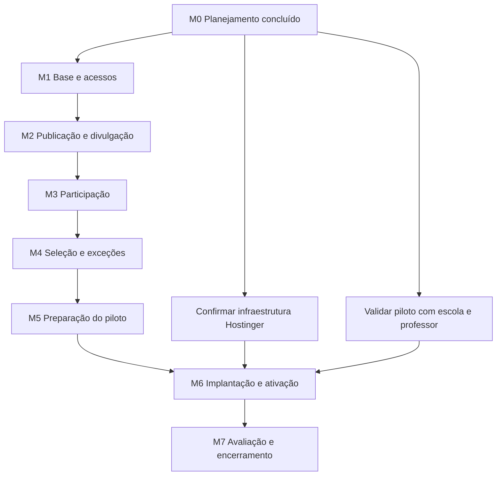

# Conecta Comunidade roadmap de desenvolvimento

O roadmap organiza a construção do MVP até a seleção manual de um prestador, seguida da implantação, avaliação e encerramento do piloto escolar. Cada marco termina com um resultado demonstrável e critérios de conclusão verificáveis.

O [plano de desenvolvimento](conecta-comunidade-plano-desenvolvimento.md) detalha as regras, a arquitetura e os testes. Este roadmap orienta a ordem de execução e o acompanhamento das entregas.

**Situação atual:** M1 concluído localmente e implementações técnicas de M2 a M5 entregues; M5 mantém validações institucionais pendentes. As avaliações de publicação, consulta e seleção com a diretora permanecem pendentes em M2.7, M3.7 e M4.8. M6 em execução, com homologação privada na VPS Hostinger KVM 2; SMTP configurado e envio de recuperação solicitado; recuperação confirmada pelo usuário; backup externo e autorização de ativação permanecem pendentes. Datas, estimativas e distribuição entre integrantes continuam em aberto. Consulte [M1 Base e acessos](docs/m1-base-acessos.md), [M2 Publicação e divulgação](docs/m2-publicacao-divulgacao.md), [M3 Participação](docs/m3-participacao.md) e [M4 Seleção e exceções](docs/m4-selecao-excecoes.md) para configuração, verificações e roteiros de avaliação.

Acompanhamento no GitHub: [issues do roadmap](https://github.com/sobucki/conecta-comunidade/issues?q=is%3Aissue) e [milestones](https://github.com/sobucki/conecta-comunidade/milestones?state=all).

## 1 Visão dos marcos

| Marco | Resultado | Dependência | Situação inicial |
| --- | --- | --- | --- |
| M0 Planejamento | Escopo, stack, regras e entregas definidos. | Refinamento dos requisitos. | Concluído |
| [M1 Base e acessos](https://github.com/sobucki/conecta-comunidade/milestone/1) | Aplicação local com escola, contas e permissões. | M0 | Concluído localmente |
| [M2 Publicação e divulgação](https://github.com/sobucki/conecta-comunidade/milestone/2) | Diretora publica; visitante consulta e compartilha. | M1 | Implementado localmente; em avaliação |
| [M3 Participação](https://github.com/sobucki/conecta-comunidade/milestone/3) | Prestador se cadastra e gerencia suas candidaturas. | M2 | Implementado localmente; em avaliação |
| [M4 Seleção e exceções](https://github.com/sobucki/conecta-comunidade/milestone/4) | Diretora seleciona e trata os demais resultados. | M3 | Implementado localmente; em avaliação |
| [M5 Preparação do piloto](https://github.com/sobucki/conecta-comunidade/milestone/5) | Indicadores, conteúdo e percursos validados. | M4 | Implementado localmente; validações pendentes |
| [M6 Implantação e ativação](https://github.com/sobucki/conecta-comunidade/milestone/6) | Ambiente de destino verificado e piloto autorizado. | M5, infraestrutura e validação institucional | Homologação privada implantada; ativação pendente |
| [M7 Avaliação e encerramento](https://github.com/sobucki/conecta-comunidade/milestone/7) | Resultados do experimento e decisão de continuidade. | M6 e período de observação definido | Planejado |

M1 a M5 correspondem às cinco entregas do plano. M6 reúne a implantação e as condições finais de ativação. M7 trata da condução e avaliação do experimento, sem acrescentar acompanhamento da execução dos serviços ao MVP.

## 2 Marcos de desenvolvimento

### M1 Base e acessos

**Objetivo:** estabelecer a aplicação e os limites de acesso antes de implementar os fluxos públicos.

- [x] Configurar o projeto único Next.js, TypeScript e Payload, fixando versões compatíveis. ([#1](https://github.com/sobucki/conecta-comunidade/issues/1))
- [x] Configurar PostgreSQL de desenvolvimento e a modelagem inicial prevista no plano. ([#2](https://github.com/sobucki/conecta-comunidade/issues/2))
- [x] Criar dados fictícios para escola, gestora, administrador e prestadores. ([#3](https://github.com/sobucki/conecta-comunidade/issues/3))
- [x] Implementar os papéis, a associação à escola e as permissões no servidor. ([#4](https://github.com/sobucki/conecta-comunidade/issues/4))
- [x] Permitir ao administrador cadastrar escola e gestora e administrar contas e bloqueios. ([#5](https://github.com/sobucki/conecta-comunidade/issues/5))
- [x] Configurar e validar a recuperação de senha por e-mail no ambiente de desenvolvimento. ([#6](https://github.com/sobucki/conecta-comunidade/issues/6))
- [x] Preparar Vitest e Playwright e verificar as permissões principais. ([#7](https://github.com/sobucki/conecta-comunidade/issues/7))

**Demonstração de conclusão:** o administrador configura uma escola e sua gestora; ela acessa somente o contexto autorizado; o prestador não acessa o painel nem concede privilégios a si próprio. A recuperação de senha é exercitada com um serviço de e-mail de desenvolvimento.

### M2 Publicação e divulgação

**Objetivo:** permitir que uma oportunidade seja publicada e compreendida por quem recebe o link.

- [x] Criar os layouts públicos e a edição de conteúdo institucional pelo administrador. ([#8](https://github.com/sobucki/conecta-comunidade/issues/8))
- [x] Implementar rascunho e publicação de oportunidades com categoria, local, prazos e valor fixo. ([#9](https://github.com/sobucki/conecta-comunidade/issues/9))
- [x] Informar responsabilidade por materiais e ferramentas nas condições do serviço. ([#10](https://github.com/sobucki/conecta-comunidade/issues/10))
- [x] Implementar até três fotos opcionais, com validação, permissões e versões reduzidas. ([#11](https://github.com/sobucki/conecta-comunidade/issues/11))
- [x] Exibir a página da escola, as oportunidades abertas e seus detalhes sem login. ([#12](https://github.com/sobucki/conecta-comunidade/issues/12))
- [x] Permitir copiar e compartilhar links, inclusive pelo WhatsApp. ([#13](https://github.com/sobucki/conecta-comunidade/issues/13))
- [ ] Avaliar pelo celular a tarefa de publicação no painel da diretora. ([#14](https://github.com/sobucki/conecta-comunidade/issues/14))

**Demonstração de conclusão:** a diretora publica uma oportunidade com foto e o visitante abre o link pelo celular sem cadastro. Rascunhos e suas fotos permanecem restritos à gestão.

### M3 Participação

**Objetivo:** completar o percurso do interessado até uma candidatura válida e acompanhável.

- [x] Implementar cadastro mínimo, login, perfil e retorno à oportunidade após autenticação. ([#15](https://github.com/sobucki/conecta-comunidade/issues/15))
- [x] Permitir candidatura sem exigir confirmação do e-mail. ([#16](https://github.com/sobucki/conecta-comunidade/issues/16))
- [x] Coletar disponibilidade e concordância com o valor fixo e as condições publicadas. ([#17](https://github.com/sobucki/conecta-comunidade/issues/17))
- [x] Implementar Minhas candidaturas com informações e situação do próprio prestador. ([#18](https://github.com/sobucki/conecta-comunidade/issues/18))
- [x] Permitir editar, retirar e reenviar enquanto as inscrições estiverem abertas, preservando o histórico. ([#19](https://github.com/sobucki/conecta-comunidade/issues/19))
- [x] Bloquear duplicidades, inscrições fora do prazo e alterações das condições após a primeira candidatura. ([#20](https://github.com/sobucki/conecta-comunidade/issues/20))
- [ ] Disponibilizar a consulta identificada de candidatos para a diretora e avaliar seu uso pelo celular. ([#21](https://github.com/sobucki/conecta-comunidade/issues/21))

**Demonstração de conclusão:** o interessado chega por um link, cria sua conta, candidata-se e acompanha o registro. Ele consegue retirar e reenviar a candidatura sem criar outra ativa. Tentativas de acessar dados de outro prestador e envios duplicados são negados, inclusive sob concorrência.

**Verificação atual:** percurso completo do prestador e consulta no painel exercitados pelo navegador com dados fictícios; 31 testes de integração e 15 percursos de navegador aprovados. A consulta identificada está implementada em M3.7; a sessão de avaliação com a diretora permanece pendente. Consulte o [guia do M3](docs/m3-participacao.md).

### M4 Seleção e exceções

**Objetivo:** concluir o fluxo da escola e preservar decisões consistentes e rastreáveis.

- [x] Implementar encerramento antecipado das inscrições e análise após o prazo. ([#22](https://github.com/sobucki/conecta-comunidade/issues/22))
- [x] Implementar seleção manual com confirmação, registrando responsável e data. ([#23](https://github.com/sobucki/conecta-comunidade/issues/23))
- [x] Atualizar as demais candidaturas elegíveis para não selecionadas. ([#24](https://github.com/sobucki/conecta-comunidade/issues/24))
- [x] Implementar desistência do selecionado e reconsideração de candidatos existentes, mantendo as inscrições fechadas. ([#25](https://github.com/sobucki/conecta-comunidade/issues/25))
- [x] Implementar cancelamento e encerramento sem seleção, com justificativa. ([#26](https://github.com/sobucki/conecta-comunidade/issues/26))
- [x] Manter links antigos acessíveis com a situação atual e sem exposição de candidatos. ([#27](https://github.com/sobucki/conecta-comunidade/issues/27))
- [x] Testar seleções concorrentes, consistência das operações e histórico. ([#28](https://github.com/sobucki/conecta-comunidade/issues/28))
- [ ] Completar a avaliação do painel da diretora e realizar as adaptações necessárias. ([#29](https://github.com/sobucki/conecta-comunidade/issues/29))

**Demonstração de conclusão:** a diretora seleciona um prestador, registra uma desistência e escolhe outro candidato existente. Somente uma seleção fica vigente. Pelo celular, ela consegue publicar com foto, consultar candidatos e selecionar sem orientação passo a passo; dificuldades identificadas são corrigidas ou atendidas por uma interface própria.

**Verificação atual:** 44 testes de integração e 20 percursos de navegador aprovados, com concorrência, rollback, desistência, reconsideração e privacidade dos links antigos. A implementação técnica está entregue; M4.8 permanece pendente até a avaliação real com a diretora e os ajustes decorrentes. Consulte o [guia do M4](docs/m4-selecao-excecoes.md).

### M5 Preparação do piloto

**Objetivo:** concluir o produto para avaliação no ambiente de destino e uso autorizado.

- [x] Implementar os seis indicadores agregados acordados, com consulta por período. ([#30](https://github.com/sobucki/conecta-comunidade/issues/30))
- [x] Definir e verificar a contagem de reenvios, os intervalos de observação e os denominadores dos indicadores. ([#31](https://github.com/sobucki/conecta-comunidade/issues/31))
- [ ] Completar os textos institucionais, termos e aviso de privacidade com a validação responsável. ([#32](https://github.com/sobucki/conecta-comunidade/issues/32))
- [ ] Informar o canal externo de suporte e definir o responsável por atendimento e administração. ([#33](https://github.com/sobucki/conecta-comunidade/issues/33))
- [ ] Executar os percursos completos de visitante, prestador e diretora pelo celular. ([#34](https://github.com/sobucki/conecta-comunidade/issues/34))
- [ ] Corrigir problemas encontrados nos testes de permissões, candidaturas, seleção, uploads e usabilidade. ([#35](https://github.com/sobucki/conecta-comunidade/issues/35))
- [x] Preparar as instruções de operação e a relação de pendências para implantação. ([#36](https://github.com/sobucki/conecta-comunidade/issues/36))

**Demonstração de conclusão:** o fluxo completo funciona com dados fictícios, os indicadores conferem com os registros e as pendências para M6 estão identificadas. A conclusão da preparação do produto não autoriza, por si só, a entrada de dados reais.

## 3 Implantação e avaliação

### M6 Implantação e ativação

**Objetivo:** verificar o ambiente de destino e ativar o piloto nas condições aprovadas pela escola.

- [x] Confirmar o plano Hostinger, execução de Node.js, acesso ao PostgreSQL e capacidade disponível. ([#37](https://github.com/sobucki/conecta-comunidade/issues/37))
- [x] Definir o mecanismo de implantação e o processo de build e migrações. ([#38](https://github.com/sobucki/conecta-comunidade/issues/38))
- [x] Configurar domínio, HTTPS, segredos da aplicação e envio de e-mail para recuperação de senha. ([#39](https://github.com/sobucki/conecta-comunidade/issues/39))
- [x] Garantir armazenamento persistente de fotos e separação entre dados fictícios e reais. ([#40](https://github.com/sobucki/conecta-comunidade/issues/40))
- [ ] Verificar a cobertura dos backups já informados da Hostinger para banco e fotos, frequência, destino e recuperação. ([#41](https://github.com/sobucki/conecta-comunidade/issues/41))
- [ ] Atender à política de backup diário e antes de atualizações e concluir um teste de restauração. ([#42](https://github.com/sobucki/conecta-comunidade/issues/42))
- [x] Verificar cadastro, recuperação de acesso, publicação, candidatura e seleção no ambiente de destino com dados fictícios. ([#43](https://github.com/sobucki/conecta-comunidade/issues/43))
- [ ] Confirmar autorização da escola, oportunidades reais, condições de divulgação, privacidade e período do piloto. ([#44](https://github.com/sobucki/conecta-comunidade/issues/44))
- [ ] Cadastrar os dados autorizados, orientar a diretora e iniciar a divulgação. ([#45](https://github.com/sobucki/conecta-comunidade/issues/45))

**Encaminhamento em 25/11/2026:** por solicitação do usuário, M6.5 e a parte pendente de M6.6 ficam adiadas, sem serem marcadas como concluídas. A escola real ainda não foi identificada. O usuário confirmou em 25/11/2026 que testou o fluxo completo sem dificuldades na homologação fictícia; essa avaliação preliminar foi concluída. A sessão com a diretora real permanece pendente. A próxima frente é M6.8: identificação da escola e validação institucional. Autorização institucional e ativação real permanecem pendentes.

**Verificação atual:** homologação privada implantada em `masque-vps` (VPS KVM 2), com imagem Linux, seis migrações aplicadas em banco vazio e percurso HTTP fictício de cadastro, publicação com foto, candidatura e seleção aprovado. Backup de banco e fotos restaurado em destino separado, com histórico e hashes de fotos/versões reduzidas conferidos. M6.6 permanece aberto porque a política diária e a cópia externa ainda não foram atendidas; SMTP Hostinger configurado em 25/11/2026, com autenticação TLS aprovada e envio de recuperação pela aplicação; M6.7 concluído tecnicamente: em 25/11/2026 o usuário confirmou recebimento, redefinição e login. A avaliação humana com a diretora permanece nos marcos anteriores. Domínio `redeconectacomunidade.com.br` e HTTPS verificados, com senha de acesso à homologação; sem ativação para participantes reais. Consulte o [guia do M6](docs/m6-implantacao-ativacao.md).

**Conclusão:** o ambiente de destino foi verificado, a restauração foi exercitada, o responsável pelo suporte está definido e a escola autorizou a ativação. A partir desse ponto, o piloto pode receber participantes e dados reais.

### M7 Avaliação e encerramento

**Objetivo:** analisar a participação e definir o destino do sistema ao término do experimento.

- [ ] Acompanhar adesão, candidaturas e dificuldades durante o período definido com a escola. ([#46](https://github.com/sobucki/conecta-comunidade/issues/46))
- [ ] Atender solicitações de suporte e registrar ajustes necessários. ([#47](https://github.com/sobucki/conecta-comunidade/issues/47))
- [ ] Coletar feedback voluntário externamente, quando aplicável. ([#48](https://github.com/sobucki/conecta-comunidade/issues/48))
- [ ] Consolidar indicadores e observações com dados agregados para o trabalho acadêmico. ([#49](https://github.com/sobucki/conecta-comunidade/issues/49))
- [ ] Avaliar as hipóteses e limitações do experimento sem equiparar seleção a contratação ou renda gerada. ([#50](https://github.com/sobucki/conecta-comunidade/issues/50))
- [ ] Registrar a decisão de continuidade ou encerramento, o responsável e o tratamento dos dados conforme as definições institucionais. ([#51](https://github.com/sobucki/conecta-comunidade/issues/51))

**Conclusão:** os resultados estão consolidados e existe uma decisão explícita sobre continuidade, suporte e encerramento do piloto.

## 4 Trabalho em paralelo

| Frente | Quando avançar | Resultado necessário |
| --- | --- | --- |
| Validação com escola e professor | Durante o desenvolvimento, usando demonstrações fictícias. | Autorização, demandas, condições do serviço, privacidade e período do experimento definidos antes da ativação. |
| Confirmação da Hostinger | VPS KVM 2 acessada e homologação privada implantada em M6. | Concluir cobertura de backups, rotina diária e cópia externa antes da ativação. |
| Usabilidade com a diretora | Publicação em M2, consulta em M3 e seleção em M4. | Decisão fundamentada sobre aproveitar o painel ou adaptar a interface. |
| Testes automatizados | Em cada marco de desenvolvimento. | Regras e fluxos relevantes verificados antes de declarar o marco concluído. |

Os detalhes pendentes da hospedagem não impedem iniciar M1 a M4 com recursos locais e dados fictícios. A implantação e a ativação permanecem dependentes da verificação do ambiente e das condições institucionais.

## 5 Controle de avanço

Um marco será considerado concluído quando suas tarefas estiverem entregues, sua demonstração tiver sido realizada, os testes relevantes tiverem passado e os problemas que impedem o uso previsto tiverem sido resolvidos.

As caixas deste documento representam trabalho a executar. A situação inicial deve ser atualizada conforme o avanço real, sem confundir conclusão de planejamento com funcionalidade implementada. Datas e distribuição de tarefas serão acrescentadas quando prazo e disponibilidade da equipe forem definidos.

As avaliações de **M2.7**, **M3.7** e **M4.8** com a diretora permanecem pendentes. A preparação técnica de **M5** está entregue. Permanecem a validação institucional dos textos e retenção e a definição nominal do responsável; o e-mail de suporte informado foi configurado localmente. O marco **M6 Implantação e ativação** está em execução, com homologação privada na VPS e restauração fictícia exercitada; a recuperação de senha foi confirmada e a ativação depende da política de backup diário/externo e das validações institucionais. Consulte o [guia do M5](docs/m5-preparacao-piloto.md). A conclusão integral de M4 depende da avaliação real do painel e dos ajustes decorrentes.

## 6 Evolução após o MVP

Uma nova priorização, após a avaliação do piloto, poderá tratar de formalização externa, agendamento, execução e validação dos serviços. Catálogo de profissionais, notificações automáticas, filtros avançados, exportações e questionários internos também permanecem como possibilidades posteriores, sem compromisso de entrega nesta sequência.

Pagamentos, integração com a API do WhatsApp e seleção automatizada permanecem fora do escopo acordado.
