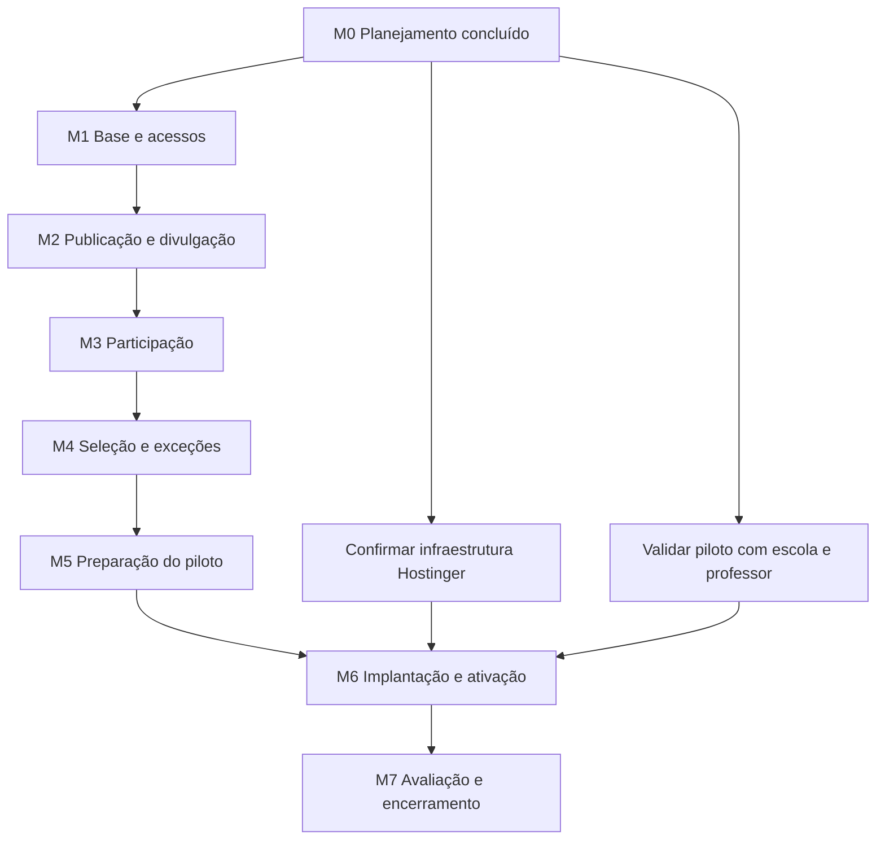

# Conecta Comunidade roadmap de desenvolvimento

O roadmap organiza a construção do MVP até a seleção manual de um prestador, seguida da implantação, avaliação e encerramento do piloto escolar. Cada marco termina com um resultado demonstrável e critérios de conclusão verificáveis.

O [plano de desenvolvimento](conecta-comunidade-plano-desenvolvimento.md) detalha as regras, a arquitetura e os testes. Este roadmap orienta a ordem de execução e o acompanhamento das entregas.

**Situação atual:** M1 Base e acessos implementado e verificado localmente. O próximo marco é M2. Datas, estimativas e distribuição entre integrantes permanecem em aberto, assim como os detalhes da hospedagem Hostinger. A configuração e as evidências do primeiro marco estão em [M1 Base e acessos](docs/m1-base-acessos.md).

## 1 Visão dos marcos

| Marco | Resultado | Dependência | Situação inicial |
| --- | --- | --- | --- |
| M0 Planejamento | Escopo, stack, regras e entregas definidos. | Refinamento dos requisitos. | Concluído |
| M1 Base e acessos | Aplicação local com escola, contas e permissões. | M0 | Concluído localmente |
| M2 Publicação e divulgação | Diretora publica; visitante consulta e compartilha. | M1 | Planejado |
| M3 Participação | Prestador se cadastra e gerencia suas candidaturas. | M2 | Planejado |
| M4 Seleção e exceções | Diretora seleciona e trata os demais resultados. | M3 | Planejado |
| M5 Preparação do piloto | Indicadores, conteúdo e percursos validados. | M4 | Planejado |
| M6 Implantação e ativação | Ambiente de destino verificado e piloto autorizado. | M5, infraestrutura e validação institucional | Pendente |
| M7 Avaliação e encerramento | Resultados do experimento e decisão de continuidade. | M6 e período de observação definido | Planejado |

M1 a M5 correspondem às cinco entregas do plano. M6 reúne a implantação e as condições finais de ativação. M7 trata da condução e avaliação do experimento, sem acrescentar acompanhamento da execução dos serviços ao MVP.

## 2 Marcos de desenvolvimento

### M1 Base e acessos

**Objetivo:** estabelecer a aplicação e os limites de acesso antes de implementar os fluxos públicos.

- [x] Configurar o projeto único Next.js, TypeScript e Payload, fixando versões compatíveis.
- [x] Configurar PostgreSQL de desenvolvimento e a modelagem inicial prevista no plano.
- [x] Criar dados fictícios para escola, gestora, administrador e prestadores.
- [x] Implementar os papéis, a associação à escola e as permissões no servidor.
- [x] Permitir ao administrador cadastrar escola e gestora e administrar contas e bloqueios.
- [x] Configurar e validar a recuperação de senha por e-mail no ambiente de desenvolvimento.
- [x] Preparar Vitest e Playwright e verificar as permissões principais.

**Demonstração de conclusão:** o administrador configura uma escola e sua gestora; ela acessa somente o contexto autorizado; o prestador não acessa o painel nem concede privilégios a si próprio. A recuperação de senha é exercitada com um serviço de e-mail de desenvolvimento.

### M2 Publicação e divulgação

**Objetivo:** permitir que uma oportunidade seja publicada e compreendida por quem recebe o link.

- [ ] Criar os layouts públicos e a edição de conteúdo institucional pelo administrador.
- [ ] Implementar rascunho e publicação de oportunidades com categoria, local, prazos e valor fixo.
- [ ] Informar responsabilidade por materiais e ferramentas nas condições do serviço.
- [ ] Implementar até três fotos opcionais, com validação, permissões e versões reduzidas.
- [ ] Exibir a página da escola, as oportunidades abertas e seus detalhes sem login.
- [ ] Permitir copiar e compartilhar links, inclusive pelo WhatsApp.
- [ ] Avaliar pelo celular a tarefa de publicação no painel da diretora.

**Demonstração de conclusão:** a diretora publica uma oportunidade com foto e o visitante abre o link pelo celular sem cadastro. Rascunhos e suas fotos permanecem restritos à gestão.

### M3 Participação

**Objetivo:** completar o percurso do interessado até uma candidatura válida e acompanhável.

- [ ] Implementar cadastro mínimo, login, perfil e retorno à oportunidade após autenticação.
- [ ] Permitir candidatura sem exigir confirmação do e-mail.
- [ ] Coletar disponibilidade e concordância com o valor fixo e as condições publicadas.
- [ ] Implementar Minhas candidaturas com informações e situação do próprio prestador.
- [ ] Permitir editar, retirar e reenviar enquanto as inscrições estiverem abertas, preservando o histórico.
- [ ] Bloquear duplicidades, inscrições fora do prazo e alterações das condições após a primeira candidatura.
- [ ] Disponibilizar a consulta identificada de candidatos para a diretora e avaliar seu uso pelo celular.

**Demonstração de conclusão:** o interessado chega por um link, cria sua conta, candidata-se e acompanha o registro. Ele consegue retirar e reenviar a candidatura sem criar outra ativa. Tentativas de acessar dados de outro prestador e envios duplicados são negados, inclusive sob concorrência.

### M4 Seleção e exceções

**Objetivo:** concluir o fluxo da escola e preservar decisões consistentes e rastreáveis.

- [ ] Implementar encerramento antecipado das inscrições e análise após o prazo.
- [ ] Implementar seleção manual com confirmação, registrando responsável e data.
- [ ] Atualizar as demais candidaturas elegíveis para não selecionadas.
- [ ] Implementar desistência do selecionado e reconsideração de candidatos existentes, mantendo as inscrições fechadas.
- [ ] Implementar cancelamento e encerramento sem seleção, com justificativa.
- [ ] Manter links antigos acessíveis com a situação atual e sem exposição de candidatos.
- [ ] Testar seleções concorrentes, consistência das operações e histórico.
- [ ] Completar a avaliação do painel da diretora e realizar as adaptações necessárias.

**Demonstração de conclusão:** a diretora seleciona um prestador, registra uma desistência e escolhe outro candidato existente. Somente uma seleção fica vigente. Pelo celular, ela consegue publicar com foto, consultar candidatos e selecionar sem orientação passo a passo; dificuldades identificadas são corrigidas ou atendidas por uma interface própria.

### M5 Preparação do piloto

**Objetivo:** concluir o produto para avaliação no ambiente de destino e uso autorizado.

- [ ] Implementar os seis indicadores agregados acordados, com consulta por período.
- [ ] Definir e verificar a contagem de reenvios, os intervalos de observação e os denominadores dos indicadores.
- [ ] Completar os textos institucionais, termos e aviso de privacidade com a validação responsável.
- [ ] Informar o canal externo de suporte e definir o responsável por atendimento e administração.
- [ ] Executar os percursos completos de visitante, prestador e diretora pelo celular.
- [ ] Corrigir problemas encontrados nos testes de permissões, candidaturas, seleção, uploads e usabilidade.
- [ ] Preparar as instruções de operação e a relação de pendências para implantação.

**Demonstração de conclusão:** o fluxo completo funciona com dados fictícios, os indicadores conferem com os registros e as pendências para M6 estão identificadas. A conclusão da preparação do produto não autoriza, por si só, a entrada de dados reais.

## 3 Implantação e avaliação

### M6 Implantação e ativação

**Objetivo:** verificar o ambiente de destino e ativar o piloto nas condições aprovadas pela escola.

- [ ] Confirmar o plano Hostinger, execução de Node.js, acesso ao PostgreSQL e capacidade disponível.
- [ ] Definir o mecanismo de implantação e o processo de build e migrações.
- [ ] Configurar domínio, HTTPS, segredos da aplicação e envio de e-mail para recuperação de senha.
- [ ] Garantir armazenamento persistente de fotos e separação entre dados fictícios e reais.
- [ ] Verificar a cobertura dos backups já informados da Hostinger para banco e fotos, frequência, destino e recuperação.
- [ ] Atender à política de backup diário e antes de atualizações e concluir um teste de restauração.
- [ ] Verificar cadastro, recuperação de acesso, publicação, candidatura e seleção no ambiente de destino com dados fictícios.
- [ ] Confirmar autorização da escola, oportunidades reais, condições de divulgação, privacidade e período do piloto.
- [ ] Cadastrar os dados autorizados, orientar a diretora e iniciar a divulgação.

**Conclusão:** o ambiente de destino foi verificado, a restauração foi exercitada, o responsável pelo suporte está definido e a escola autorizou a ativação. A partir desse ponto, o piloto pode receber participantes e dados reais.

### M7 Avaliação e encerramento

**Objetivo:** analisar a participação e definir o destino do sistema ao término do experimento.

- [ ] Acompanhar adesão, candidaturas e dificuldades durante o período definido com a escola.
- [ ] Atender solicitações de suporte e registrar ajustes necessários.
- [ ] Coletar feedback voluntário externamente, quando aplicável.
- [ ] Consolidar indicadores e observações com dados agregados para o trabalho acadêmico.
- [ ] Avaliar as hipóteses e limitações do experimento sem equiparar seleção a contratação ou renda gerada.
- [ ] Registrar a decisão de continuidade ou encerramento, o responsável e o tratamento dos dados conforme as definições institucionais.

**Conclusão:** os resultados estão consolidados e existe uma decisão explícita sobre continuidade, suporte e encerramento do piloto.

## 4 Trabalho em paralelo

| Frente | Quando avançar | Resultado necessário |
| --- | --- | --- |
| Validação com escola e professor | Durante o desenvolvimento, usando demonstrações fictícias. | Autorização, demandas, condições do serviço, privacidade e período do experimento definidos antes da ativação. |
| Confirmação da Hostinger | Quando o usuário disponibilizar os detalhes. | Compatibilidade da aplicação, banco, fotos, e-mail e backups confirmada antes de M6. |
| Usabilidade com a diretora | Publicação em M2, consulta em M3 e seleção em M4. | Decisão fundamentada sobre aproveitar o painel ou adaptar a interface. |
| Testes automatizados | Em cada marco de desenvolvimento. | Regras e fluxos relevantes verificados antes de declarar o marco concluído. |

Os detalhes pendentes da hospedagem não impedem iniciar M1 a M4 com recursos locais e dados fictícios. A implantação e a ativação permanecem dependentes da verificação do ambiente e das condições institucionais.

## 5 Controle de avanço

Um marco será considerado concluído quando suas tarefas estiverem entregues, sua demonstração tiver sido realizada, os testes relevantes tiverem passado e os problemas que impedem o uso previsto tiverem sido resolvidos.

As caixas deste documento representam trabalho a executar. A situação inicial deve ser atualizada conforme o avanço real, sem confundir conclusão de planejamento com funcionalidade implementada. Datas e distribuição de tarefas serão acrescentadas quando prazo e disponibilidade da equipe forem definidos.

O próximo trabalho é **M2 Publicação e divulgação**, aproveitando a base de contas, escolas e permissões implementada no M1.

## 6 Evolução após o MVP

Uma nova priorização, após a avaliação do piloto, poderá tratar de formalização externa, agendamento, execução e validação dos serviços. Catálogo de profissionais, notificações automáticas, filtros avançados, exportações e questionários internos também permanecem como possibilidades posteriores, sem compromisso de entrega nesta sequência.

Pagamentos, integração com a API do WhatsApp e seleção automatizada permanecem fora do escopo acordado.
